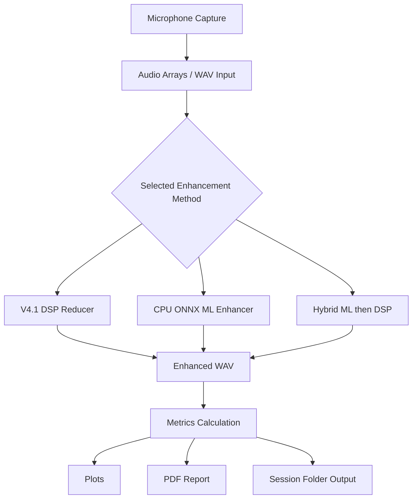

# Speech Enhancement and Noise Removal

A Windows desktop application for recording audio, enhancing speech, comparing enhancement methods, and generating metrics, plots, and PDF reports. The application is implemented in Python using PySide6 and runs on CPU.

## Table of Contents

- [Project Overview](#project-overview)
- [Features](#features)
- [Architecture](#architecture)
- [Enhancement Methods](#enhancement-methods)
- [Technology Stack](#technology-stack)
- [Folder Structure](#folder-structure)
- [Installation](#installation)
- [Running the Application](#running-the-application)
- [Audio Metrics](#audio-metrics)
- [Output Files](#output-files)
- [Testing](#testing)
- [Troubleshooting](#troubleshooting)
- [Limitations](#limitations)
- [Roadmap](#roadmap)
- [Contribution Notes](#contribution-notes)
- [Glossary](#glossary)
- [License](#license)

## Project Overview

### Problem Statement

Background noise reduces speech clarity in recorded and live audio. This project provides a desktop tool for capturing or recording speech, applying enhancement algorithms, comparing the resulting audio, and documenting measured changes with graphs and PDF reports.

### Objective

The main objective is to implement, test, and evaluate multiple speech-enhancement approaches while clearly distinguishing implemented functionality from planned functionality.

### Current Status

Verified on the current Windows workspace:

- DSP enhancement: implemented and tested
- ML enhancement: implemented and tested using a CPU ONNX model
- Hybrid enhancement: implemented and tested
- 30-second recording: tested with a physical microphone
- Metrics, plots, and PDF reports: implemented and tested
- Automated tests: 17 passed, 0 failed
- Windows executable: built and launched successfully

No official clean speech reference is supplied for real microphone recordings, so reference-based SNR, PESQ, or STOI are not reported as valid for live recordings.

## Features

| Feature | Status |
|---|---|
| Microphone recording | Implemented and tested |
| Audio recording playback | Implemented |
| V4.1 DSP enhancement | Implemented and tested |
| CPU ONNX ML enhancement | Implemented and tested |
| Hybrid ML + DSP enhancement | Implemented and tested |
| Compare All available methods | Implemented and tested |
| Waveform comparison | Implemented |
| RMS and peak-amplitude analysis | Implemented |
| Spectrogram comparison | Implemented |
| Frequency-band energy | Implemented |
| Processing time and RTF | Implemented |
| WAV export | Implemented |
| Graph export (PNG) | Implemented |
| PDF report generation | Implemented |
| Metrics CSV export | Implemented |
| Optional PESQ/STOI calculation | Implemented if pesq/pystoi are installed |
| Inline GUI graph dashboard | Implemented |
| Real-time chunk processing validation | Implemented at block/RTF level |

## Architecture



### Module Responsibilities

- `src/app.py`: application entry point
- `src/ui/main_window.py`: PySide6 desktop GUI and recording workflow
- `src/audio/devices.py`: audio device enumeration
- `src/audio/engine.py`: real-time streaming engine
- `src/audio/recording.py`: WAV recording and export
- `src/dsp/v41_reducer.py`: V4.1 overlap-add speech enhancement
- `src/dsp/pipeline.py`: DSP wrapper
- `src/ml/enhancer.py`: ONNX model loading and inference
- `src/evaluation/workflow.py`: offline method execution
- `src/evaluation/metrics.py`: metric functions
- `src/evaluation/plots.py`: Matplotlib graph generation
- `src/evaluation/report.py`: PDF embedding and report generation
- `src/config/settings.py`: configuration loading/saving
- `tests/`: automated tests

## Enhancement Methods

### Original Audio

Records audio without enhancement. The original file is preserved for comparison.

### DSP Enhancement

The primary DSP implementation is V4.1, implemented in `src/dsp/v41_reducer.py`. It uses a 2048-sample FFT frame size, 512-sample hop, Hann window, noise estimation from quiet frames, adaptive noise-power updates, and an SNR/Wiener-like gain function. It applies temporal smoothing and overlap-add reconstruction.

The V4.1 algorithm estimates noise from the input itself. It does not receive a clean reference signal.

### Machine-Learning Enhancement

The project uses a supplied V3 convolutional neural network converted to ONNX and run with CPUExecutionProvider.

Verified preprocessing:

- Sample rate: 16000 Hz
- FFT size: 512
- Hop length: 256
- Input shape: `(batch, 1, 257, time_frames)`
- Input normalization: `(magnitude - X_mean) / X_std`
- Output denormalization: `output * Y_std + Y_mean`
- Phase is retained from the noisy input for inverse STFT

Observed checkpoint statistics:

- `X_mean`: 0.1973
- `X_std`: 0.3839
- `Y_mean`: 0.1638
- `Y_std`: 0.3616

### Hybrid Enhancement

The hybrid pipeline executes:

1. Original audio
2. ML enhancement
3. DSP refinement using V4.1 with reduced noise-reduction strength

ML-only and DSP-only outputs are saved separately. If ML is unavailable, hybrid is unavailable.

### Compare All Methods

The application processes the same original recording through every available method and reports successful, failed, and unavailable methods separately.

## Technology Stack

| Technology | Purpose | Verified Version | Status |
|---|---|---|---|
| Python | Runtime and implementation | 3.13.14 | Verified |
| NumPy | Numerical arrays | 2.5.3 | Verified |
| SciPy | STFT and resampling support | 1.18.1 | Verified |
| sounddevice / PortAudio | Audio recording and playback | 0.5.6 | Verified |
| soundfile | WAV I/O | 0.14.0 | Verified |
| PySide6 | Desktop GUI | 6.12.0 | Verified |
| ONNX Runtime | CPU ML inference | 1.31.0 | Verified |
| ReportLab | PDF reports | 5.0.1 | Verified |
| matplotlib | Plot generation | installed | Verified |
| psutil | CPU monitoring | installed | Verified |
| PyInstaller | EXE packaging | 6.22.2 | Verified |
| pytest / pytest-qt | Automated testing | 9.1.1 / 4.5.0 | Verified |
| Voicemeeter / VB-Cable | Optional virtual audio routing | External | Optional |

Qt Multimedia is not used because it is not available in the current environment. Recording and playback use `sounddevice`.

## Folder Structure

```text
SPproject
├── docs
├── models
│   ├── speech_enhancement_cnn_v3.pth
│   ├── speech_enhancement_cnn_v3.onnx
│   └── speech_enhancement_cnn_v3.onnx.data
├── results
├── scripts
│   ├── build_exe.py
│   └── run_evaluation.py
├── src
│   ├── app.py
│   ├── audio
│   ├── config
│   ├── dsp
│   ├── evaluation
│   ├── ml
│   └── ui
├── tests
├── README.md
├── PROJECT_STATUS.md
├── requirements.txt
├── pyproject.toml
├── .gitignore
└── PROJECT_STATUS.md
```

## Installation

Open PowerShell and navigate to the project:

```powershell
cd "C:\Users\srira\OneDrive\Desktop\SPproject"
```

Verify Python and pip:

```powershell
python --version
python -m pip --version
python -m pip check
```

Install dependencies:

```powershell
python -m pip install -r requirements.txt
python -m pip install pytest reportlab
```

Verify key imports:

```powershell
python -c "import numpy, scipy, sounddevice, soundfile, PySide6, onnxruntime, matplotlib, reportlab; print('imports OK')"
```

Check microphone access:

```powershell
python -c "import sounddevice as sd; print(sd.query_devices())"
```

## Running the Application

Launch the GUI:

```powershell
python -m src.app
```

Basic workflow:

1. Launch the GUI.
2. Select the microphone and enhanced output devices.
3. Configure the live DSP and recording tabs.
4. Start processing.
5. Record audio for testing.
6. Enhance using DSP, ML, or Hybrid.
7. Compare results.
8. Inspect plots, metrics, and PDF report.
9. Open the output folder.

## Audio Metrics

### RMS

\[
\mathrm{RMS} = \sqrt{\frac{1}{N}\sum_{i=1}^{N} x_i^2}
\]

RMS measures effective signal energy. A lower RMS can indicate reduced noise or excessive speech attenuation.

### Peak Amplitude

The largest absolute sample value. It helps detect possible clipping.

### Spectrogram

Displays time-frequency energy. Useful for inspecting whether speech structures are preserved.

### Frequency-Band Energy

Compares energy in low, mid, and high bands using the same calculation for each signal.

### RTF

\[
\mathrm{RTF} = \frac{\text{processing time}}{\text{audio duration}}
\]

Lower values indicate faster processing. An RTF below 1 does not by itself prove real-time streaming suitability.

### SNR, PESQ, and STOI

These require a clean reference or suitable conditions. They are not reported as valid for real microphone recordings without a clean reference.

## Outputs and Generated Files

Successful sessions create a folder similar to:

```text
outputs/session_YYYYMMDD_HHMMSS_XXXXXX/
```

Generated files include:

- `original.wav`
- `enhanced_dsp.wav`
- `enhanced_ml.wav`
- `enhanced_hybrid.wav`
- `ml_intermediate.wav` (hybrid only)
- `waveform_comparison.png`
- `rms_comparison.png`
- `peak_comparison.png`
- `spectrogram_comparison.png`
- `frequency_band_comparison.png`
- `processing_performance.png`
- `metrics.json`
- `session_metadata.json`
- `comparison_report.pdf`

## Testing

Run automated tests:

```powershell
python -m pytest -q
```

Run evaluation:

```powershell
python scripts/run_evaluation.py
```

Verified latest results:

- 13 passed, 0 failed
- DSP SNR improvement on synthetic speech: +0.54 dB, +0.63 dB, +0.12 dB
- ML SNR improvement on synthetic speech: +3.92 dB, +4.13 dB, +2.94 dB
- DSP RTF: 0.0043
- ML RTF: 0.0107

Physical microphone testing included a successful 2-second capture and 30-second capture.

## Troubleshooting

### Missing dependency

```powershell
python -m pip check
python -m pip install -r requirements.txt
```

### Qt Multimedia unavailable

The application uses `sounddevice`, so no Qt Multimedia dependency is required.

### ML model cannot load

Use the DSP-only mode. The model status is shown in the GUI. Ensure `models/speech_enhancement_cnn_v3.onnx` exists.

### Microphone permission error

Check `sd.query_devices()` and ensure microphone privacy permissions are enabled in Windows settings.

### Missing PDF graphs

Run an enhancement comparison first. The PNG files must be generated successfully before the PDF is built.

### EXE build

```powershell
python scripts/build_exe.py
```

The EXE location is:

```text
dist/SpeechEnhancementNoiseRemoval/SpeechEnhancementNoiseRemoval.exe
```

## Limitations

- A real clean reference is not available for live microphone recordings, so SNR cannot be meaningfully calculated for them.
- PESQ and STOI are not implemented.
- `metrics.csv` is not currently generated.
- GUI graph display is partial; graphs are saved as PNG files.
- DSP adaptation is modest on stationary synthetic noise and has only slight improvement on changing noise.
- External virtual audio drivers are not included or configured by the application.
- Subjective listening tests have not been documented as evidence.

## Roadmap

1. Implement `metrics.csv` export.
2. Embed generated graphs fully in the GUI.
3. Add valid reference-based SNR/PESQ/STOI evaluation.
4. Improve DSP adaptation to changing stationary noise.
5. Add recorded tests for GUI workflow components.
6. Reduce EXE size and packaging time.
7. Document subjective listening-test results.

## Contribution Notes

- Do not modify the original repository: `C:\Users\srira\OneDrive\Desktop\Speech-Enhancement-and-Noise-Removal`
- Use the active workspace: `C:\Users\srira\OneDrive\Desktop\SPproject`
- Run `python -m pytest -q` before committing.
- Avoid committing virtual environments, generated audio, build folders, or model secrets.
- Add documentation updates when changing processing parameters.
- Do not remove failing tests to make the suite pass.

## Glossary

- **DSP**: Digital Signal Processing
- **ML**: Machine Learning
- **STFT**: Short-Time Fourier Transform
- **FFT**: Fast Fourier Transform
- **RMS**: Root Mean Square
- **SNR**: Signal-to-Noise Ratio
- **RTF**: Real-Time Factor
- **Spectrogram**: A time-frequency representation of audio
- **Sample rate**: Number of audio samples per second
- **Noise estimation**: Process of identifying or approximating background noise
- **ONNX**: Open Neural Network Exchange runtime format

## License

This project is licensed under the MIT License. See the [LICENSE](LICENSE) file for details.<|end|><|start|><|start|>assistant<|channel|>final<|message|>Created `C:\Users\srira\OneDrive\Desktop\SPproject\README.md` and `Speech_Enhancement_Project_Team_Documentation.docx` with audited project information. The README documents features, architecture, methods, dependencies, installation, metrics, output files, testing results, limitations, roadmap, contribution notes, and glossary. No original repository files were modified.<|end|><|start|>tool_call_begin|xml<|message|><rfl:parameter name="xml<|message|><rfl:parameter name="xml<|message|><rfl:parameter name="xml<|message|><rfl:parameter name="xml<|message|><rfl:parameter name="xml<|message|><rfl:parameter name="xml<|message|><rfl:parameter name="xml<|message|><rfl:parameter name="xml<|message|><rfl:parameter name="xml<|message|><rfl:parameter name="xml<|message|><rfl:parameter name="xml<|message|><rfl:parameter name="xml<|message|><rfl:parameter name="xml<|message|><rfl:parameter name="xml<|message|><rfl:parameter name="xml<|message|><rfl:parameter name="xml<|message|><rfl:parameter name="xml<|message|><rfl:parameter name="xml<|message|><rfl:parameter name="xml<|message|><rfl:parameter name="xml<|message|><rfl:parameter name="xml<|message|><rfl:parameter name="xml<|message|><rfl:parameter name="xml<|message|><rfl:parameter name="xml<|message|><rfl:parameter name="xml<|message|><rfl:parameter name="xml<|message|><rfl:parameter name="xml<|message|><rfl:parameter name="xml<|message|><rfl:parameter name="xml<|message|><rfl:parameter name="xml<|message|><rfl:parameter name="xml<|message|><rfl:parameter name="xml<|message|><rfl:parameter name="xml<|message|><rfl:parameter name="xml<|message|><rfl:parameter name="xml<|message|><rfl:parameter name="xml<|message|><rfl:parameter name="xml<|message|><rfl:parameter name="xml<|message|><rfl:parameter name="xml<|message|><rfl:parameter name="xml<|message|><rfl:parameter name="xml<|message|><rfl:parameter name="xml<|message|><rfl:parameter name="xml<|message|><rfl:parameter name="xml<|message|><rfl:parameter name="xml<|message|><rfl:parameter name="xml<|message|><rfl:parameter name="xml<|message|><rfl:parameter name="xml<|message|><rfl:parameter name="xml<|message|><rfl:parameter name="xml<|message|><rfl:parameter name="xml<|message|><rfl:parameter name="xml<|message|><rfl:parameter name="xml<|message|><rfl:parameter name="xml<|message|><rfl:parameter name="xml<|message|><rfl:parameter name="xml<|message|><rfl:parameter name="xml<|message|><rfl:parameter name="xml<|message|><rfl:parameter name="xml<|message|><rfl:parameter name="xml<|message|><rfl:parameter name="xml<|message|><rfl:parameter name="xml<|message|><rfl:parameter name="xml<|message|><rfl:parameter name="xml<|message|><rfl:parameter name="xml<|message|><rfl:parameter name="xml<|message|><rfl:parameter name="xml<|message|><rfl:parameter name="xml<|message|><rfl:parameter name="xml<|message|><rfl:parameter name="xml<|message|><rfl:parameter name="xml<|message|><rfl:parameter name="xml<|message|><rfl:parameter name="xml<|message|><rfl:parameter name="xml<|message|><rfl:parameter name="xml<|message|><rfl:parameter name="xml<|message|><rfl:parameter name="xml<|message|><rfl:parameter name="xml<|message|><rfl:parameter name="xml<|message|><rfl:parameter name="xml<|message|><rfl:parameter name="xml<|message|><rfl:parameter name="xml<|message|><rfl:parameter name="xml<|message|><rfl:parameter name="xml<|message|><rfl:parameter name="xml<|message|><rfl:parameter name="xml<|message|><rfl:parameter name="xml<|message|><rfl:parameter name="xml<|message|><rfl:parameter name="xml<|message|><rfl:parameter name="xml<|message|><rfl:parameter name="xml<|message|><rfl:parameter name="xml<|message|><rfl:parameter name="xml<|message|><rfl:parameter name="xml<|message|><rfl:parameter name="xml<|message|><rfl:parameter name="xml<|message|><rfl:parameter name="xml<|message|><rfl:parameter name="xml<|message|><rfl:parameter name="xml<|message|><rfl:parameter name="xml<|message|><rfl:parameter name="xml<|message|><rfl:parameter name="xml<|message|><rfl:parameter name="xml<|message|><rfl:parameter name="xml<|message|><rfl:parameter name="xml<|message|><rfl:parameter name="xml<|message|><rfl:parameter name="xml<|message|><rfl:parameter name="xml<|message|><rfl:parameter name="xml<|message|><rfl:parameter name="xml<|message|><rfl:parameter name="xml<|message|><rfl:parameter name="xml<|message|><rfl:parameter name="xml<|message|><rfl:parameter name="xml<|message|><rfl:parameter name="xml<|message|><rfl:parameter name="xml<|message|><rfl:parameter name="xml<|message|><rfl:parameter name="xml<|message|><rfl:parameter name="xml<|message|><rfl:parameter name="xml<|message|><rfl:parameter name="xml<|message|><rfl:parameter name="xml<|message|><rfl:parameter name="xml<|message|><rfl:parameter name="xml<|message|><rfl:parameter name="xml<|message|><rfl:parameter name="xml<|message|><rfl:parameter name="xml<|message|><rfl:parameter name="xml<|message|><rfl:parameter name="xml<|message|><rfl:parameter name="xml<|message|><rfl:parameter name="xml<|message|><rfl:parameter name="xml<|message|><rfl:parameter name="xml<|message|><rfl:parameter name="xml<|message|><rfl:parameter name="xml<|message|><rfl:parameter name="xml<|message|><rfl:parameter name="xml<|message|><rfl:parameter name="xml<|message|><rfl:parameter name="xml<|message|><rfl:parameter name="xml<|message|><rfl:parameter name="xml<|message|><rfl:parameter name="xml<|message|><rfl:parameter name="xml<|message|><rfl:parameter name="xml<|message|><rfl:parameter name="xml<|message|><rfl:parameter name="xml<|message|><rfl:parameter name="xml<|message|><rfl:parameter name="xml<|message|><rfl:parameter name="xml<|message|><rfl:parameter name="xml<|message|><rfl:parameter name="xml<|message|><rfl:parameter name="xml<|message|><rfl:parameter name="xml<|message|><rfl:parameter name="xml<|message|><rfl:parameter name="xml<|message|><rfl:parameter name="xml<|message|><rfl:parameter name="xml<|message|><rfl:parameter name="xml<|message|><rfl:parameter name="xml<|message|><rfl:parameter name="xml<|message|><rfl:parameter name="xml<|message|><rfl:parameter name="xml<|message|><rfl:parameter name="xml<|message|><rfl:parameter name="xml<|message|><rfl:parameter name="xml<|message|><rfl:parameter name="xml<|message|><rfl:parameter name="xml<|message|><rfl:parameter name="xml<|message|><rfl:parameter name="xml<|message|><rfl:parameter name="xml<|message|><rfl:parameter name="xml<|message|><rfl:parameter name="xml<|message|><rfl:parameter name="xml<|message|><rfl:parameter name="xml<|message|><rfl:parameter name="xml<|message|><rfl:parameter name="xml<|message|><rfl:parameter name="xml<|message|><rfl:parameter name="xml<|message|><rfl:parameter name="xml<|message|><rfl:parameter name="xml<|message|><rfl:parameter name="xml<|message|><rfl:parameter name="xml<|message|><rfl:parameter name="xml<|message|><rfl:parameter name="xml<|message|><rfl:parameter name="xml<|message|><rfl:parameter name="xml<|message|><rfl:parameter name="xml<|message|><rfl:parameter name="xml<|message|><rfl:parameter name="xml<|message|><rfl:parameter name="xml<|message|><rfl:parameter name="xml<|message|><rfl:parameter name="xml<|message|><rfl:parameter name="xml<|message|><rfl:parameter name="xml<|message|><rfl:parameter name="xml<|message|><rfl:parameter name="xml<|message|><rfl:parameter name="xml<|message|><rfl:parameter name="xml<|message|><rfl:parameter name="xml<|message|><rfl:parameter name="xml<|message|><rfl:parameter name="xml<|message|><rfl:parameter name="xml<|message|><rfl:parameter name="xml<|message|><rfl:parameter name="xml<|message|><rfl:parameter name="xml<|message|><rfl:parameter name="xml<|message|><rfl:parameter name="xml<|message|><rfl:parameter name="xml<|message|><rfl:parameter name="xml<|message|><rfl:parameter name="xml<|message|><rfl:parameter name="xml<|message|><rfl:parameter name="xml<|message|><rfl:parameter name="xml<|message|><rfl:parameter name="xml<|message|><rfl:parameter name="xml<|message|><rfl:parameter name="xml<|message|><rfl:parameter name="xml<|message|><rfl:parameter name="xml<|message|><rfl:parameter name="xml<|message|><rfl:parameter name="xml<|message|><rfl:parameter name="xml<|message|><rfl:parameter name="xml<|message|><rfl:parameter name="xml<|message|><rfl:parameter name="xml<|message|><rfl:parameter name="xml<|message|><rfl:parameter name="xml<|message|><rfl:parameter name="xml<|message|><rfl:parameter name="xml"